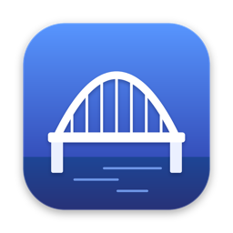

<p align="center"></p>

<h1 align="center">BridgEddy</h1>

<p align="center">Abre la sesión de otro usuario del mismo Mac en una ventana — y deshazlo todo al terminar.</p>

<p align="center"><a href="README.md">English</a> · <a href="README.pt-BR.md">Português</a></p>

---

## Por qué

Compartir Pantalla de macOS puede abrir una **sesión virtual separada** para otro usuario, pero se niega a conectarse al propio Mac ("no está permitido en localhost"). La solución clásica es un túnel SSH escrito en la Terminal. BridgEddy lo hace con un clic.

Útil si tienes una cuenta personal y una de trabajo en el mismo Mac y necesitas usar apps de las dos a la vez.

## Qué hace

1. Eliges el usuario de destino y haces clic en **Conectar**.
2. Si **Compartir Pantalla** o **Sesión remota** están desactivados, los activa (pide la contraseña de administrador una vez).
3. Crea una **clave SSH temporal**, limitada a este Mac y solo al puerto de Compartir Pantalla, y abre un túnel local.
4. Abre Compartir Pantalla en `vnc://localhost:590x` y copia el nombre de usuario. Inicia sesión y elige abrir una sesión propia.
5. Cuando cierras la ventana de Compartir Pantalla, **lo deshace todo**: cierra el túnel, borra la clave y desactiva solo los servicios que él activó — incluso si la app se cierra o falla.

Si la conexión se cae justo después del inicio de sesión con "no está permitido en localhost", Compartir Pantalla se trabó: BridgEddy ofrece el botón **Reiniciar Compartir Pantalla** y vuelve a conectar.

## Compilar

Requiere macOS 13+ y las herramientas de línea de comandos de Xcode (`xcode-select --install`).

```bash
./build.sh                 # compila, instala en ~/Applications y abre
SKIP_INSTALL=1 ./build.sh  # solo compila en build/
```

## Limitaciones conocidas

- La sesión virtual hereda las pantallas físicas del Mac; usa el menú de pantallas de Compartir Pantalla para mostrar solo una.
- El audio y la aceleración gráfica dentro de la sesión virtual son limitados.
- En algunas versiones de macOS, activar Compartir Pantalla por línea de comandos está bloqueado; entonces BridgEddy abre los ajustes de Compartir para que lo actives.

## Apoya

BridgEddy es gratuito y de código abierto. Si te ayudó, una donación de agradecimiento mantiene el proyecto ❤️

- 🇧🇷 **PIX:** `pix@xwa.com.br` (o **Apoyar el proyecto** dentro de la app, con código QR)
- 🌎 **[GitHub Sponsors](https://github.com/sponsors/lordironballs)**
- ⭐ ¡Darle una estrella al repositorio y recomendarlo también ayuda mucho!

## Licencia

[MIT](LICENSE) © 2026 [Eddy Antonini](https://eddyantonini.com.br)
